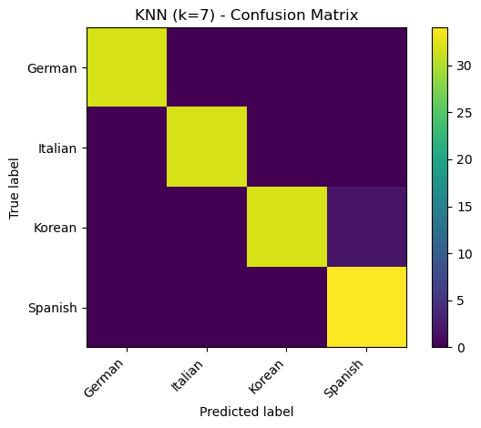
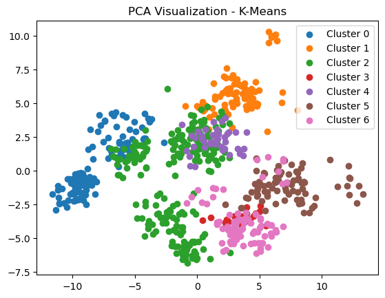

# Spoken Language Identification

A speech-based machine learning pipeline for identifying German, Italian, Korean and Spanish from short audiobook recordings. The project combines audio preprocessing, handcrafted acoustic features, supervised classification and unsupervised clustering. The core learning algorithms and evaluation routines are implemented with NumPy; Librosa is used for signal processing.

## Pipeline

MP3 corpus → quality checks and duration filtering → mono 16 kHz WAV → 128 acoustic features → classification / clustering → evaluation.

- 720 source clips; 655 retained after duration filtering.
- RMS, zero-crossing rate, spectral descriptors, MFCCs and their deltas, and chroma features; mean and standard deviation pooling.
- Supervised classification: stratified 523/132 train/test split (seed 42), train-only standardization and six PCA components.
- Unsupervised clustering: all 128 standardized descriptors, K-Means and agglomerative average linkage, two-dimensional PCA visualization.

## Results

The following metrics are from the saved notebook outputs, not from a new execution.

| Classifier | Test accuracy | Macro F1 | Weighted F1 |
|---|---:|---:|---:|
| **KNN (k=7)** | **98.48%** | **0.9853** | **0.9848** |
| MLP | 95.45% | 0.9554 | 0.9545 |
| Linear SVM (OvR) | 94.70% | 0.9472 | 0.9466 |



| Clustering | k | Custom silhouette-like score | Purity |
|---|---:|---:|---:|
| K-Means | 7 | 0.3605 | 0.7206 |
| Hierarchical | 4 | 0.2765 | 0.2840 |



KNN performs best on this clip-level holdout. The seven-cluster K-Means solution has partial language alignment, while hierarchical clustering is dominated by a large mixed cluster. These are dataset-specific findings, not evidence of speaker-independent generalization. The silhouette implementation differs from the conventional definition, and clustering methods use different cluster counts. See [experimental analysis](docs/experimental_analysis.md) for details.

## Repository contents

| Notebook | Purpose |
|---|---|
| [Data Cleaning and Feature Extraction](notebooks/Data_Cleaning_and_Feature_Extraction.ipynb) | Audio inventory, filtering, WAV preprocessing and acoustic features |
| [Classification](notebooks/Classification.ipynb) | Manual KNN, linear SVM and MLP; held-out metrics |
| [Clustering](notebooks/Clustering.ipynb) | Manual K-Means and hierarchical clustering; elbow, PCA and purity |
| [Evaluation](notebooks/Evaluation.ipynb) | Consolidated performance tables |

- [Methodology](docs/methodology.md): preprocessing, features and model mathematics.
- [Experimental analysis](docs/experimental_analysis.md): results, interpretations and limitations.
- [Dataset setup](datasets/README.md): required audio layout and generated files.
- [Results](results/README.md): metrics, cluster composition and original plots.

## Dataset

- [Original multilingual audio corpus (Google Drive)](https://drive.google.com/drive/folders/1Jb0PLfvtUfYd05odIsg2IR3q8nEmPfzx?usp=sharing). Access permissions and redistribution rights have not been independently verified.
- `datasets/features_table.csv`: the supplied extracted feature table, containing 655 clips, 128 numeric descriptors and three metadata columns (`language`, `gender`, `processed_path`). It is included in the local project archive and ignored by Git by default pending permission and review of file identifiers.

| Language | Clips |
|---|---:|
| German | 158 |
| Italian | 159 |
| Korean | 170 |
| Spanish | 168 |
| **Total** | **655** |

## Getting started

Install the dependencies from the repository root in an isolated Python environment:

```bash
python -m pip install -r requirements.txt
cd notebooks
jupyter notebook
```

Keep the working directory set to `notebooks/` when executing the notebooks. To reproduce the full pipeline, obtain the audio corpus and place it in the layout described in [datasets/README.md](datasets/README.md). Run the four notebooks in the order listed above. Classification and clustering can also run independently once `datasets/features_table.csv` is available. MP3 decoding requires an available backend; FFmpeg may be needed depending on the system and audio library installation.

The local project archive includes the feature table, so classification and clustering can be executed without downloading audio. For a Git clone without the table, obtain the supplied feature table or generate it from the audio corpus using the first notebook. Raw audio is not bundled; use the Google Drive link above. The saved outputs and extracted aggregate CSVs and figures are included for inspection. Evaluation can be executed directly using the included summary CSVs without audio. Dependencies are specified without exact version pins because the original environment was not supplied. Full end-to-end execution requires access to the audio corpus.

## Limitations

- Clip-level stratification does not guarantee separate speakers, audiobooks or recording sources across training and test sets.
- A single split and fixed hyperparameters are used; there is no external test corpus, repeated split, or feature ablation study.
- Clustering is exploratory, with unequal cluster counts and a nonstandard silhouette-like score. No t-SNE implementation is included.
- Original saved outputs retain local path strings, file identifiers and dependency warnings. The dataset source and redistribution permissions must be verified before sharing source audio or derived tables.


