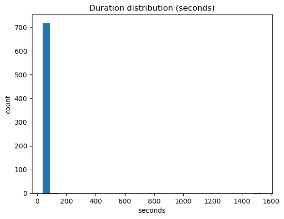
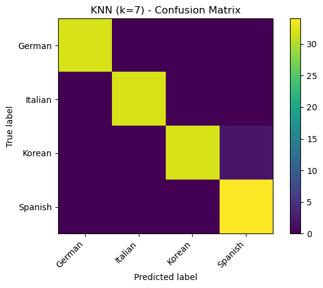
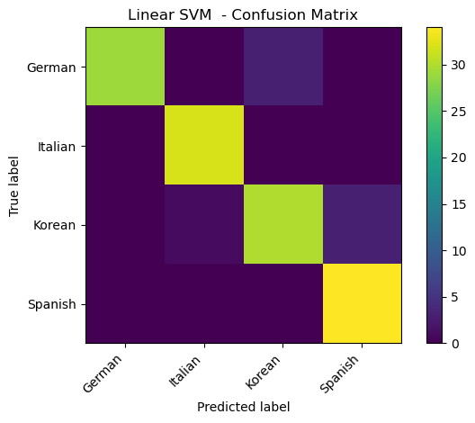
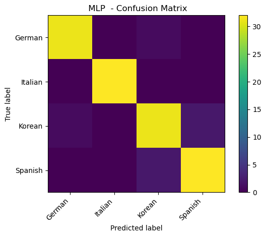
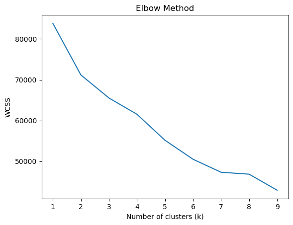
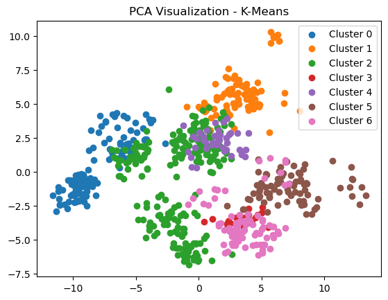
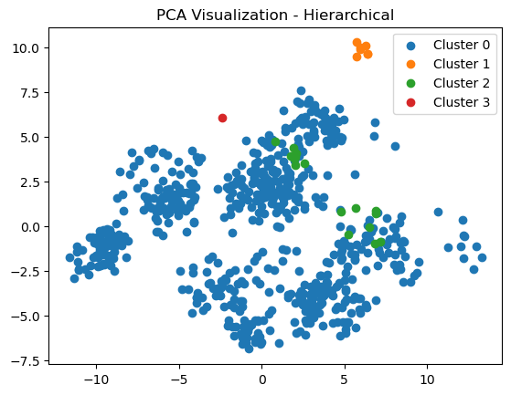

# Experimental Analysis

This analysis uses the recorded notebook outputs and the accompanying project report. No new model training or metric recomputation is represented as an experimental result.

## Dataset and feature extraction

| Quantity | Recorded value |
|---|---:|
| Source clips | 720 |
| Unreadable MP3 metadata | 0 |
| Duration outliers | 65 |
| Retained clips | 655 |
| Successful feature rows | 655 |
| Numeric features | 128 |
| Training / test clips | 523 / 132 |

The duration distribution contains an extreme long clip (1534.24 seconds), supporting the choice of a 50–70 second input-duration range. The filtering does not guarantee equal lengths after silence trimming.

Class totals inferred by summing the recorded cluster compositions are German 158, Italian 159, Korean 170 and Spanish 168. The corpus is approximately balanced after filtering.

## Classification

| Model | Accuracy | Macro precision | Macro recall | Macro F1 | Weighted precision | Weighted recall | Weighted F1 |
|---|---:|---:|---:|---:|---:|---:|---:|
| KNN | 0.984848 | 0.986111 | 0.985294 | 0.985281 | 0.985690 | 0.984848 | 0.984835 |
| MLP | 0.954545 | 0.955423 | 0.955423 | 0.955423 | 0.954545 | 0.954545 | 0.954545 |
| Linear SVM | 0.946970 | 0.949427 | 0.947151 | 0.947176 | 0.948353 | 0.946970 | 0.946554 |

KNN makes two errors on the 132 test clips; the MLP makes six and the linear SVM seven. KNN leads on all recorded aggregate metrics. The high scores of all models indicate that the selected acoustic statistics and six-dimensional PCA representation contain discriminative information for this corpus. KNN's local decision rule may exploit compact class neighborhoods that a linear separator cannot fully capture; the MLP can learn nonlinear boundaries but is sensitive to architecture and optimization choices. These are plausible interpretations rather than experimentally isolated causes.

### Confusion matrices

The matrices show mostly diagonal mass, consistent with high test accuracy. The original plots are retained without generating substitute figures. Macro and weighted averages are close, consistent with the approximately balanced supports.

## Clustering

The elbow curve examines k from 1 to 9. The report selects seven as a visual tradeoff between compactness and cluster count, not as a mathematically unique optimum. Seven exceeds the four known languages.

| Method | k | Custom silhouette-like score | Purity |
|---|---:|---:|---:|
| K-Means | 7 | 0.360533 | 0.720611 |
| Hierarchical | 4 | 0.276468 | 0.283969 |

### Cluster composition

| K-Means cluster | German | Italian | Korean | Spanish | Total |
|---|---:|---:|---:|---:|---:|
| 0 | 32 | 1 | 86 | 0 | 119 |
| 1 | 0 | 82 | 0 | 0 | 82 |
| 2 | 84 | 0 | 56 | 84 | 224 |
| 3 | 0 | 0 | 20 | 0 | 20 |
| 4 | 41 | 0 | 0 | 0 | 41 |
| 5 | 0 | 0 | 0 | 83 | 83 |
| 6 | 1 | 76 | 8 | 1 | 86 |

Four clusters are single-language groups, but other clusters are mixed. In particular, cluster 2 contains 224 clips from three languages. The seven-group structure may capture acoustic variation unrelated to language, such as narrator or recording conditions; this hypothesis has not been tested.

| Hierarchical cluster | German | Italian | Korean | Spanish | Total |
|---|---:|---:|---:|---:|---:|
| 0 | 158 | 145 | 169 | 159 | 631 |
| 1 | 0 | 7 | 0 | 0 | 7 |
| 2 | 0 | 7 | 0 | 9 | 16 |
| 3 | 0 | 0 | 1 | 0 | 1 |

The hierarchical solution assigns 631 of 655 clips (96.34%) to one mixed cluster. This explains the low purity and is consistent with the weak separation in the PCA plot. The implementation uses average linkage, so the imbalance alone is not evidence of the classic single-linkage chaining effect.

K-Means has stronger observed scores, but the cluster counts differ and purity rewards finer partitions. The silhouette-like computation uses squared distances and includes self-distance, so its reported values must not be compared directly with conventional silhouette scores. The PCA images visualize only two components, and clustering is performed in 128 dimensions.

## Interpretation and scope

The supervised and unsupervised results are not contradictory: the former uses labels and a six-component representation, whereas the latter explores the full standardized feature space without labels. Language discrimination on a clip-level split can coexist with mixed unsupervised groups. A speaker- or book-disjoint split is necessary to assess generalization to unseen sources. Other useful extensions would be repeated seeded splits, feature ablation, validation-based hyperparameter selection, conventional silhouette scores and matched-k comparisons with multiple initializations. These are suggested checks, not additional experiments included in the repository.
